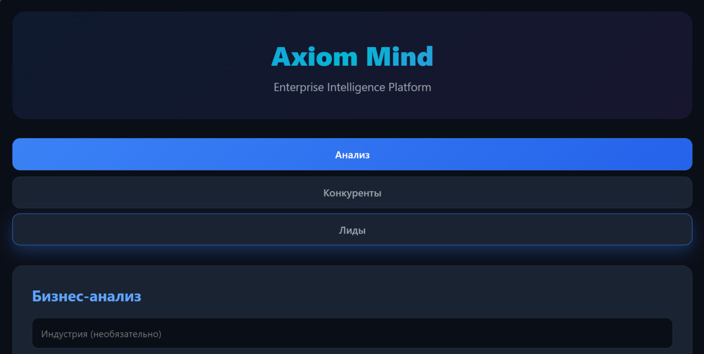
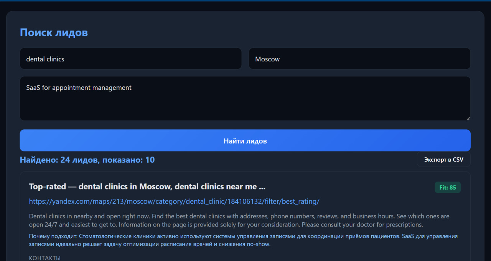
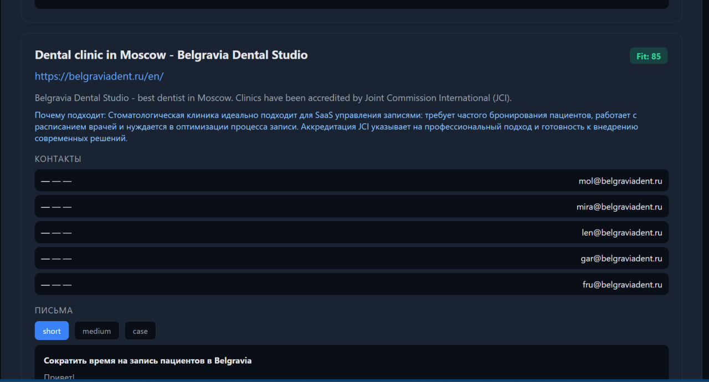
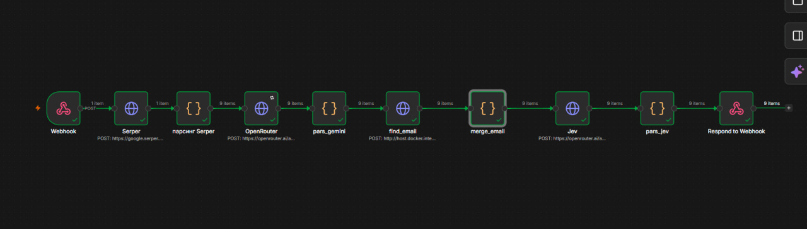

# Axiom Mind — AI Agent for B2B Lead Generation


**IT Enthusiast & Future Fachinformatikerin | Building AI automation tools (n8n, Python) | Focus: Data & Process Analysis | Russia → Germany 🇩🇪**

---

> **Project Status: Paused.**  
> The project is paused due to technical constraints (sanctions, unavailable email services, lack of hosting budget) and a shift in focus to vocational training (Ausbildung) in Germany. The project remains part of my portfolio.

---

AI agent that finds B2B companies, scores them by fit, finds real emails, and writes personalized cold emails.

## 🎯 Problem

B2B outreach is broken. People buy lists of 10,000 emails. 90% bounce. 0.1% reply.

Companies waste hours manually researching prospects. Then send generic emails that nobody reads.

## 💡 Solution

**Zero-Trust Outbound:**
- **Signal-First** — find companies with a trigger (new SDR hire, funding round, CRO change)
- **Verified-Only** — email verified at send time. Bounce <1% or refund
- **5-Minute Review** — human in the loop, but no routine

## 🛠️ Stack

| Component | Technology |
|---|---|
| Orchestration | n8n (Docker) |
| Backend | FastAPI (Python) |
| Database | Supabase (PostgreSQL) |
| LLM | OpenRouter (Gemini 2.5 Flash / NVIDIA Nemotron) |
| Search | Serper.dev |
| Email finder | Custom (website scrape + SMTP verify) |

## 🏗️ Architecture
[Frontend: index.html]
↓
[FastAPI: main.py]
↓
[n8n Webhook → Serper → Code → OpenRouter → Code → Iteration → find_email → Code → Jev → Code → Respond]
↓
[Supabase: leads, contacts, emails, searches]

text

## 🚀 What Works

- ✅ Find companies by niche + city (Serper)
- ✅ Fit-score 0–100 with explanation (OpenRouter)
- ✅ 3 variants of cold emails (short, medium, case)
- ✅ Save to Supabase
- ✅ Honest email finder (no fake emails, SMTP verification)
  

## 📸 Screenshots

### 1. Web Interface — Main Page


### 2. Web Interface — Search Results


### 3. Web Interface — Lead Card & Emails


### 4. n8n Workflow (Final)

## 🔮 What's Next (potential return)

- [ ] Connect FastAPI ↔ n8n
- [ ] Add Signals (hiring, funding, CRO change)
- [ ] Frontend RU/EN
- [ ] Hosting (VPS, 24/7)
- [ ] Monetization (Lemon Squeezy)
- [ ] **Potential return after Ausbildung in Germany**

## 📂 Project Structure

```text
axiom-mind/
├── main.py              # FastAPI backend
├── email_finder.py      # Honest email finder
├── email_verify.py      # SMTP verification
├── index.html           # Frontend
├── requirements.txt     # Dependencies
├── supabase_schema.sql  # Database schema
└── screenshots/
    ├── 01-web-main.png
    ├── 02-web-results.png
    ├── 03-web-lead.png
    └── 04-workflow-final.png
```

## 🚀 How to Run

1. Install Docker Desktop
2. Run n8n:
```bash
docker run -it --rm --name n8n -p 5678:5678 -v n8n_data:/home/node/.n8n docker.n8n.io/n8nio/n8n
Run FastAPI:

bash
cd axiom-mind
pip install -r requirements.txt
python main.py
Open index.html in browser

👩‍💻 Author
Valya — 17-year-old self-taught AI developer.
IT Enthusiast & Future Fachinformatikerin
Building AI automation tools (n8n, Python)
Focus: Data & Process Analysis
Russia → Germany 🇩🇪

X (Twitter): @valyadefton
GitHub: @valyadefton

📄 License
MIT License — see LICENSE file
